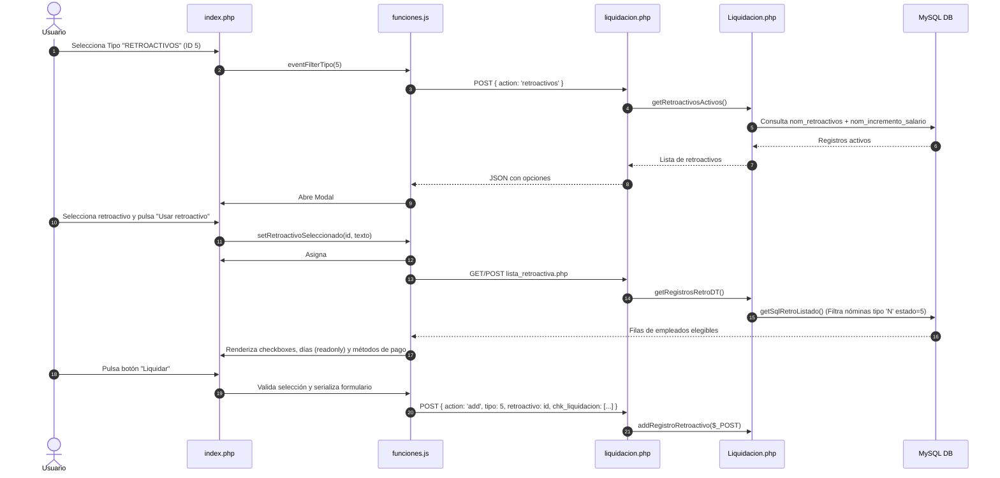

# Documentación Técnica: Proceso de Liquidación de Retroactivos (ID 5)

Este documento detalla la arquitectura, el flujo de datos, las fórmulas matemáticas y la persistencia en base de datos del proceso de **Liquidación de Retroactivos** (Tipo `5` / Código `'RA'`), accesible desde la vista de liquidación de nómina.

---

## 1. Arquitectura y Componentes del Sistema

El flujo completo involucra los siguientes archivos y capas:

| Capa | Archivo / Recurso | Responsabilidad |
| :--- | :--- | :--- |
| **Vista (UI)** | [`src/nomina/liquidacion/php/index.php`](file:///c:/wamp64/www/nuevo/src/nomina/liquidacion/php/index.php) | Renderiza la interfaz, filtros (`#filter_tipo`, `#filter_mes`), campo oculto `#filter_retroactivo` y la tabla DataTables `#tableLiqMesEmpleados`. |
| **JavaScript** | [`src/nomina/liquidacion/js/funciones.js`](file:///c:/wamp64/www/nuevo/src/nomina/liquidacion/js/funciones.js) | Gestiona eventos de filtro, apertura del modal para elegir el retroactivo, cambio dinámico de URL del DataTable y serialización/envío para liquidar. |
| **Fuente DataTable** | [`src/nomina/liquidacion/php/lista_retroactiva.php`](file:///c:/wamp64/www/nuevo/src/nomina/liquidacion/php/lista_retroactiva.php) | Endpoint AJAX que consulta los empleados candidatos y consolida días laborados, incapacidades, licencias y vacaciones. |
| **Controlador** | [`src/nomina/liquidacion/php/controladores/liquidacion.php`](file:///c:/wamp64/www/nuevo/src/nomina/liquidacion/php/controladores/liquidacion.php) | Expone las acciones `retroactivos` (lista opciones de retroactivos) y `add` (procesa la liquidación). |
| **Lógica de Negocio** | [`src/nomina/liquidacion/php/clases/Liquidacion.php`](file:///c:/wamp64/www/nuevo/src/nomina/liquidacion/php/clases/Liquidacion.php) | Métodos centrales: `getRetroactivosActivos()`, `getRetroactivoById()`, `getSqlRetroListado()` y `addRegistroRetroactivo()`. |
| **Servicios de Nómina** | [`src/nomina/liquidacion/php/clases/Nomina.php`](file:///c:/wamp64/www/nuevo/src/nomina/liquidacion/php/clases/Nomina.php) | Creación/búsqueda de cabecera de nómina `nom_nominas` (`getIDNomina`, `addRegistro`, `getParamLiq`). |
| **Seguridad Social** | [`src/nomina/empleados/php/clases/Seguridad_Social.php`](file:///c:/wamp64/www/nuevo/src/nomina/empleados/php/clases/Seguridad_Social.php) | Inserción en `nom_liq_segsocial_empdo` y `nom_liq_parafiscales`. |
| **Prestaciones** | [`src/nomina/empleados/php/clases/Prestaciones_Sociales.php`](file:///c:/wamp64/www/nuevo/src/nomina/empleados/php/clases/Prestaciones_Sociales.php) | Inserción en `nom_liq_prestaciones_sociales`. |

---

## 2. Prerrequisitos en la Base de Datos

Para que una liquidación retroactiva se procese correctamente, deben cumplirse las siguientes condiciones previas:

1. **Incremento Salarial Vigente (`nom_incremento_salario`):**
   - Debe existir un registro de incremento con su porcentaje y vigencia.
   - Cada empleado no acogido a salario mínimo debe tener actualizado su salario en `nom_salarios_basico` referenciando el `id_inc`.
2. **Definición del Retroactivo (`nom_retroactivos`):**
   - Registro en estado activo (`estado = 1`) vinculado al `id_incremento`.
   - Debe contener `fec_inicio`, `fec_final`, `meses` y `vigencia`.
3. **Nóminas Ordinarias Cerradas (`nom_nominas`):**
   - Las nóminas ordinarias mensuales (`tipo = 'N'`) dentro del rango de fechas deben tener `estado = 5` (cerradas/aprobadas).
4. **Parámetros Anuales de Nómina (`nom_valxvigencia`):**
   - `id_concepto = 1`: Salario Mínimo Legal Vigente (SMMLV).
   - `id_concepto = 6`: Valor de la UVT (Unidad de Valor Tributario).
5. **Afiliaciones de Seguridad Social (`nom_novedades_ss`):**
   - El empleado debe tener asignada EPS (`tipo 1`), Fondo de Pensiones (`tipo 2`) y ARL (`tipo 3`).

---

## 3. Flujo en la Interfaz de Usuario y Eventos

---

## 4. Criterios de Selección de Empleados (`lista_retroactiva.php`)

La consulta SQL generada en `getSqlRetroListado` realiza lo siguiente:
- Relaciona `nom_nominas` (`tipo = 'N'` y `estado = 5`) comprendidas entre `fec_inicio` y `fec_final` con `nom_liq_salario` y `nom_empleado`.
- **Exclusión de Salario Mínimo:** Excluye a los empleados cuyo salario coincida con el SMMLV (`sal.salario_basico <> smmlv`), dado que los salarios mínimos se rigen por ajuste de decreto al inicio de vigencia.
- **Consolidación de Días y Novedades:**
  - Días laborados en el período: `SUM(IFNULL(d.dias_liq, 0))`
  - Días de incapacidad: `SUM(IFNULL(inc.dias, 0))`
  - Días de licencias: Luto, maternidad/paternidad y no remuneradas.
  - Días de vacaciones disfrutadas en el período.
  - Cantidad de nóminas/meses liquidados: `COUNT(DISTINCT n.id_nomina)`.

---

## 5. Proceso Técnico de Liquidación (`addRegistroRetroactivo`)

Al ejecutar `addRegistroRetroactivo($_POST)`:

### Paso 1: Gestión de la Cabecera de Nómina (`nom_nominas`)
1. Determina el mes de causación: el especificado por el usuario o por defecto el mes posterior a `fec_final`:
   $$\text{mesNomina} = \text{date}('m', \text{strtotime}(fec\_final + 1 \text{ month}))$$
2. Verifica mediante `Nomina::getIDNomina($mesNomina, 5, $retro['id_incremento'])` si existe una nómina abierta con `tipo = 'RA'`.
3. Si no existe, crea la cabecera en `nom_nominas` con:
   - `tipo`: `'RA'`
   - `id_incremento`: ID del incremento salarial.
   - `estado`: `1` (preliminar / en edición).
   - `descripcion`: `LIQUIDACIÓN RETROACTIVA DE NOMINAS DE [fec_inicio] A [fec_final]`.

### Paso 2: Procesamiento por Empleado (Transacción Individual)
Cada empleado en `chk_liquidacion` se procesa bajo su propia transacción (`beginTransaction()`):

1. **Recuperación del Histórico (`getRetroMensualData`):**
   Obtiene cada nómina ordinaria aprobada en el rango, extrayendo:
   - Días y valor básico laborado.
   - Horas extras liquidadas.
   - Aportes de seguridad social (salud emp/empresa, pensión emp/empresa, solidaridad, ARL).
   - Aportes parafiscales (SENA, ICBF, Caja de Compensación).
   - Provisiones de prestaciones sociales (vacaciones, cesantías, intereses, primas).
   - Retenciones en la fuente aplicadas.

2. **Cálculo de Diferenciales Mes a Mes:**
   Para cada mes liquidado del empleado:
   
   - **Salario anterior e incremento real:**
     $$\text{oldSalary} = \frac{\text{val\_laborado} \times 30}{\max(1, \text{dias\_laborados})}$$
     $$\text{factorFila} = \frac{\text{salarioNuevo}}{\text{oldSalary}}$$

   - **Diferencia de Devengados:**
     $$\Delta \text{Laborado} = \text{Redondear}(\text{val\_laborado} \times (\text{factorFila} - 1))$$
     $$\Delta \text{HorasExtras} = \text{Redondear}(\text{horas\_ext} \times (\text{factorFila} - 1))$$

   - **Recálculo de IBC y Seguridad Social (`calcularSeguridadSocialRetro`):**
     - Base IBC anterior inferida: $\text{IBC}_{ant} = \frac{\text{aporte\_salud\_emp}}{0.04}$ (o suma de devengados).
     - Nuevo IBC: $\text{IBC}_{nuevo} = \text{IBC}_{ant} \times \text{factorFila}$.
     - Acotado legal: $\min(25 \times \text{SMMLV}, \max(\text{SMMLV}, \text{IBC}_{nuevo}))$.
     - Aportes recalculados:
       - Salud: Empleado $4\%$, Empresa $8.5\%$ (Total $12.5\%$).
       - Pensión: Empleado $4\%$, Empresa $12\%$ (Total $16\%$).
       - Fondo Solidaridad Pensional: $1\%$ si $\text{IBC} \ge 4 \times \text{SMMLV}$ y $< 16 \times \text{SMMLV}$.
       - ARL: $\text{IBC} \times \text{porcentajeArl}$.
     - Diferencias por pagar/descontar:
       $$\Delta \text{SegSocial} = \text{AporteNuevo} - \text{AporteAnterior}$$

   - **Diferencia de Parafiscales:**
     Ajuste de SENA, ICBF y Comfamiliar aplicando $(\text{factorFila} - 1)$ redondeado a centenas.

   - **Diferencia de Provisiones de Prestaciones:**
     Ajuste sobre cesantías, intereses a cesantías, prima de servicios, prima de navidad, vacaciones y bonificación de recreación aplicando $(\text{factorFila} - 1)$.

   - **Recálculo de Retención en la Fuente (`calcularRetencionBase`):**
     - Nueva base tributaria: $\text{BaseRet}_{nueva} = \text{base\_ret} \times \text{factorFila}$.
     - Conversión a UVT: $\text{IngLabUvt} = \frac{\text{BaseRet}_{nueva}}{\text{UVT}}$.
     - Aplicación de tabla de retención del Art. 383 del Estatuto Tributario:
       - 0 a 95 UVT: $0\%$
       - 95 a 150 UVT: $(\text{IngLabUvt} - 95) \times 19\% \times \text{UVT}$
       - 150 a 360 UVT: $((\text{IngLabUvt} - 150) \times 28\% + 10) \times \text{UVT}$
       - 360 a 640 UVT: $((\text{IngLabUvt} - 360) \times 33\% + 69) \times \text{UVT}$
       - 640 a 945 UVT: $((\text{IngLabUvt} - 640) \times 35\% + 162) \times \text{UVT}$
       - 945 a 2300 UVT: $((\text{IngLabUvt} - 945) \times 37\% + 268) \times \text{UVT}$
       - \> 2300 UVT: $((\text{IngLabUvt} - 2300) \times 39\% + 770) \times \text{UVT}$
     - Diferencial de retención:
       $$\Delta \text{Retención} = \text{Retención}_{nueva} - \text{val\_ret}$$

   - **Determinación del Salario Neto:**
     $$\text{Neto} = (\Delta \text{Laborado} + \Delta \text{HorasExtras}) - (\Delta \text{Salud}_{emp} + \Delta \text{Pensión}_{emp} + \Delta \text{Solidaridad} + \Delta \text{Retención})$$

---

## 6. Modelo de Datos y Tablas Afectadas

Durante la persistencia de cada empleado, el sistema escribe en 6 tablas relacionales de liquidación:

| Tabla de Base de Datos | Método Invocado | Contenido Registrado |
| :--- | :--- | :--- |
| **`nom_nominas`** | `Nomina::addRegistro` | Cabecera general de la nómina retroactiva (`tipo = 'RA'`). |
| **`nom_liq_dlab_auxt`** | `Liquidacion::LiquidaLaborado` | Días totales laborados acumulados, $\Delta \text{Laborado}$, $\Delta \text{HorasExtras}$, auxilios en 0, `id_nomina`. |
| **`nom_liq_segsocial_empdo`** | `Seguridad_Social::addRegistroLiq` | Diferenciales de Salud y Pensión (empleado y empresa), Fondo de Solidaridad, ARL, EPS, AFP y ARL. |
| **`nom_liq_parafiscales`** | `Seguridad_Social::addRegistroLiq2` | Diferenciales a pagar de SENA, ICBF y Comfamiliar. |
| **`nom_liq_prestaciones_sociales`** | `Prestaciones_Sociales::addRegistroLiq` | Diferenciales de provisión de cesantías, intereses, prima de servicios, prima de navidad, prima de vacaciones y bonificación de recreación. |
| **`nom_retencion_fte`** | `Liquidacion::insertRetencionFuenteRetro` | Base gravable diferencial y valor de retención en la fuente adicional. |
| **`nom_liq_salario`** | `Liquidacion::LiquidaSalarioNeto` | Salario básico vigente, contrato, método de pago, valor neto diferencial a pagar y `id_nomina`. |

---

## 7. Control de Transacciones y Auditoría

- **Aislamiento por Empleado:** El procesamiento de cada empleado se envuelve en un bloque `try/catch` con `beginTransaction()` y `commit()`.
- **Manejo de Excepciones:** Si algún empleado falla (falta de afiliados a seguridad social, salario no actualizado o error SQL), se realiza un `rollBack()` solo para ese empleado y se acumula el mensaje de error en la respuesta, permitiendo que los empleados válidos sí se liquiden.
- **Trazabilidad (`Logs::guardaLog`):** Cada inserción en las tablas de detalle registra la sentencia SQL, el usuario en sesión (`id_user`), la fecha y hora de la operación en el log de auditoría.

