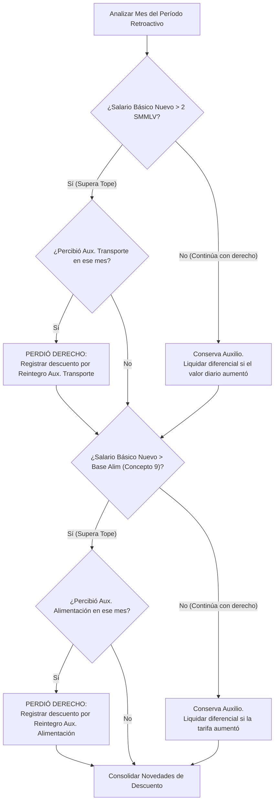
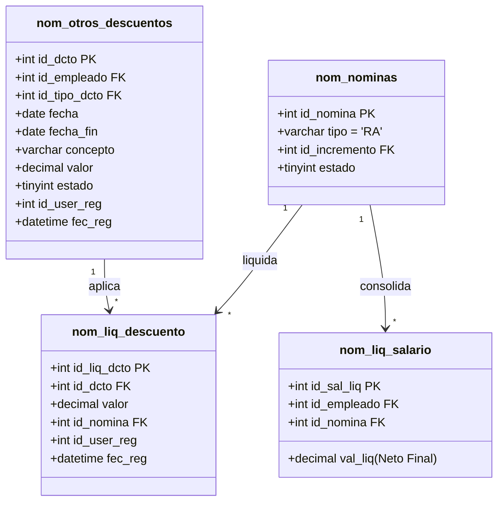

# Plan de Trabajo: Implementación de Validaciones Normativas en Liquidación de Retroactivos (ID 5)

> [!IMPORTANT]
> **Propósito del Documento:**  
> Este plan de trabajo define la arquitectura técnica, las reglas de negocio, las fórmulas matemáticas y el procedimiento de persistencia para incorporar cuatro validaciones legales indispensables en el módulo de liquidación de nóminas retroactivas ([`Liquidacion::addRegistroRetroactivo`](file:///c:/wamp64/www/nuevo/src/nomina/liquidacion/php/clases/Liquidacion.php#L717)), incluyendo el tratamiento formal de reintegros por pérdida de beneficios a través de las tablas [`nom_otros_descuentos`](file:///c:/wamp64/www/nuevo/src/nomina/empleados/php/clases/Otros_Descuentos.php#L306) y [`nom_liq_descuento`](file:///c:/wamp64/www/nuevo/src/nomina/empleados/php/clases/Otros_Descuentos.php#L338).

---

## 1. Resumen Ejecutivo y Marco Normativo

Al aplicar un incremento salarial de forma retroactiva sobre meses cerrados, la nueva asignación básica mensual puede provocar que el empleado cruce umbrales jurídicos determinantes. Estas transiciones alteran retroactivamente los derechos y obligaciones del empleado:

```
┌───────────────────────────────────────────────────────────────────────────────────┐
│                           TRANSICIONES DE UMBRALES LEGALES                        │
├─────────────────────┬───────────────────────────────┬─────────────────────────────┤
│ CONCEPTO            │ UMBRAL NORMATIVO              │ EFECTO DEL INCREMENTO       │
├─────────────────────┼───────────────────────────────┼─────────────────────────────┤
│ 1. Retención Fuente │ ≥ 95 UVT depuradas            │ Pasa de exento a retener o  │
│                     │ (Art. 383 Estatuto Tributario)│ salta de rango tarifario    │
├─────────────────────┼───────────────────────────────┼─────────────────────────────┤
│ 2. Fondo Solidaridad│ ≥ 4 SMMLV (Escala hasta 20+)  │ Pasa de 0% a 1% o más en    │
│    Pensional (FSP)  │ (Ley 100/93, Dec. 1833/2016)  │ la escala progresiva        │
├─────────────────────┼───────────────────────────────┼─────────────────────────────┤
│ 3. Aux. Transporte  │ ≤ 2 SMMLV (Ley 15/1959)       │ Si supera 2 SMMLV: PIERDE   │
│    y Alimentación   │ ≤ Base Alim. (Dec. Salarial)  │ derecho. Se descuenta lo    │
│                     │                               │ pagado indebidamente        │
├─────────────────────┼───────────────────────────────┼─────────────────────────────┤
│ 4. Bonificación por │ Base Tope Gubernamental       │ Si supera el tope: su tarifa│
│    Servicios (BSP)  │ (Concepto 7 nom_valxvigencia) │ baja del 53% al 38%         │
└─────────────────────┴───────────────────────────────┴─────────────────────────────┘
```

> [!NOTE]
> **Principio de Reintegro:**  
> Cuando el empleado **pierde beneficios** (Auxilio de Transporte, Auxilio de Alimentación o reajuste descendente en BSP), los valores que percibió en las nóminas ordinarias cerradas se convierten en un saldo a favor de la entidad. Para garantizar la trazabilidad contable y auditoría, **estos cobros no se restan arbitrariamente de los devengados**, sino que se registran formalmente como **novedad de descuento** en `nom_otros_descuentos` y se liquidan en `nom_liq_descuento`.

---

## 2. Especificación Detallada de las 4 Validaciones

### 2.1. Validación 1: Sujeción y Recálculo de Retención en la Fuente

* **Fundamento Legal:** Estatuto Tributario, Arts. 206, 383, 387 y 388.
* **Problema Actual:** El código actual multiplica la base anterior por un factor lineal (`$baseRet * $factorFila`), ignorando que los mayores aportes a Seguridad Social y FSP son Ingresos No Constitutivos de Renta (INCR) y modifican la depuración.
* **Regla de Negocio:**
  1. Reconstruir el ingreso laboral gravable de cada mes:
     $$\text{Ingreso Bruto Mensual} = \text{SalarioNuevoLaborado} + \text{HorasExtrasNuevas} + \text{OtrosDevengados}$$
  2. Deducir los INCR actualizados:
     $$\text{INCR} = \text{SaludEmpleadoNuevo} + \text{PensiónEmpleadoNuevo} + \text{FSP\_Nuevo}$$
  3. Deducir las Rentas Exentas (25% laboral tras deducciones de ley, acotado a topes UVT).
  4. Determinar la nueva base depurada en UVT:
     $$\text{BaseDepuradaUVT} = \frac{\text{BaseDepuradaPesos}}{\text{ValorUVT}}$$
  5. Aplicar la tabla de retención Art. 383:
     - Si $\text{BaseDepuradaUVT} < 95 \rightarrow \text{Retención} = \$0$.
     - Si $\text{BaseDepuradaUVT} \ge 95 \rightarrow$ Calcular el impuesto y restar lo retenido en la nómina ordinaria:
       $$\Delta \text{Retención} = \text{RetenciónNueva} - \text{RetenciónPagada}$$

---

### 2.2. Validación 2: Fondo de Solidaridad Pensional (FSP Progresivo)

* **Fundamento Legal:** Ley 100 de 1993, Art. 27; Ley 797 de 2003; Decreto 1833 de 2016.
* **Problema Actual:** Solo liquida el 1% entre 4 y 16 SMMLV. No contempla rangos superiores ni identifica empleados que antes ganaban $< 4$ SMMLV y ahora entran por primera vez a pagar FSP.
* **Escala Progresiva Obligatoria:**

| Rango de IBC en SMMLV | % Subcuenta Solidaridad | % Subcuenta Subsistencia | % Tarifa Total FSP |
| :---: | :---: | :---: | :---: |
| **$< 4\text{ SMMLV}$** | $0.0\%$ | $0.0\%$ | **$0.0\%$ (Exento)** |
| **$\ge 4 \text{ y } < 16\text{ SMMLV}$** | $0.5\%$ | $0.5\%$ | **$1.0\%$** |
| **$\ge 16 \text{ y } < 17\text{ SMMLV}$** | $0.5\%$ | $0.7\%$ | **$1.2\%$** |
| **$\ge 17 \text{ y } < 18\text{ SMMLV}$** | $0.5\%$ | $0.9\%$ | **$1.4\%$** |
| **$\ge 18 \text{ y } < 19\text{ SMMLV}$** | $0.5\%$ | $1.1\%$ | **$1.6\%$** |
| **$\ge 19 \text{ y } \le 20\text{ SMMLV}$** | $0.5\%$ | $1.3\%$ | **$1.8\%$** |
| **$> 20\text{ SMMLV}$** | $0.5\%$ | $1.5\%$ | **$2.0\%$** |

* **Regla de Cálculo:**
  $$\Delta \text{FSP} = (\text{IBC\_Nuevo} \times \% \text{TarifaTotal}) - \text{FSP\_Pagado}$$
  El total de $\Delta \text{FSP}$ se acumula y se registra en [`nom_liq_segsocial_empdo.aporte_solidaridad_pensional`](file:///c:/wamp64/www/nuevo/src/nomina/liquidacion/php/clases/Liquidacion.php#L894).

---

### 2.3. Validación 3: Pérdida o Ganancia de Auxilios (Transporte y Alimentación)

* **Fundamento Legal:** Ley 15 de 1959; Decreto 1258 de 1959; Decretos Salariales Anuales del Sector Público.
* **Problema Actual:** El retroactivo fija los auxilios en 0 (`val_aux_trans = 0`, `val_aux_alim = 0`), ignorando que un aumento puede hacer que el empleado pierda el derecho a los auxilios que cobró en los meses pasados.
* **Condiciones de Acceso:**
  - **Auxilio de Transporte:** Salario Básico Mensual $\le 2 \times \text{SMMLV}$.
  - **Auxilio de Alimentación:** Salario Básico Mensual $\le \text{BaseAlimentación}$ (`Concepto 9` de `nom_valxvigencia`).



* **Tratamiento del Reintegro por Pérdida:**
  Los valores cobrados indebidamente se totalizan para todo el período y se insertan en:
  1. [`nom_otros_descuentos`](file:///c:/wamp64/www/nuevo/src/nomina/empleados/php/clases/Otros_Descuentos.php#L306):
     - `id_tipo_dcto`: Tipo correspondiente a reintegros de nómina.
     - `concepto`: `"REINTEGRO AUXILIO DE TRANSPORTE - RETROACTIVO [fec_inicio a fec_final]"`.
     - `valor`: Suma total de los auxilios a reintegrar.
  2. [`nom_liq_descuento`](file:///c:/wamp64/www/nuevo/src/nomina/empleados/php/clases/Otros_Descuentos.php#L338):
     - `id_dcto`: ID generado en el paso anterior.
     - `id_nomina`: ID de la nómina retroactiva.
     - `valor`: Valor a descontar.

---

### 2.4. Validación 4: Bonificación por Servicios Prestados (Cruce de Tope 53% a 38%)

* **Fundamento Legal:** Decreto 2418 de 2015; Decreto 304 de 2020; Decretos Salariales Anuales.
* **Problema Actual:** `getRetroMensualData` no cruza la tabla `nom_liq_bsp`. Si un empleado cumplió su anualidad en un mes del retroactivo y cobró BSP con la tarifa del 53%, al subir el sueldo básico por encima del tope legal gubernamental su tarifa debió ser del 38%.
* **Regla de Cálculo:**
  1. Identificar si en el período existe un registro en `nom_liq_bsp` (`estado = 1`).
  2. Comparar la asignación básica más gastos de representación con `base_bsp` (`Concepto 7` en `nom_valxvigencia`):
     - $\text{BaseAnterior} = \text{SalarioAnterior} + \text{Grep} \le \text{base\_bsp} \rightarrow \text{Liquidada al } 53\%$.
     - $\text{BaseNueva} = \text{SalarioNuevo} + \text{Grep} > \text{base\_bsp} \rightarrow \text{Aplica Tarifa del } 38\%$.
  3. Recálculo del valor debido:
     $$\text{BSP\_Nueva} = \text{Valores::Redondear}\left(\text{BaseNueva} \times 0.38 \times \frac{\text{días}}{360}\right)$$
     $$\Delta \text{BSP} = \text{BSP\_Nueva} - \text{BSP\_Pagada}$$
  4. **Determinación del Impacto:**
     - Si $\Delta \text{BSP} > 0$: Se liquida como mayor valor devengado en la nómina retroactiva (`nom_liq_bsp`).
     - Si $\Delta \text{BSP} < 0$: El empleado cobró un exceso de BSP. La diferencia negativa se registra como **descuento por reintegro de bonificación** en `nom_otros_descuentos` y `nom_liq_descuento`.
  5. **Incidencia en Seguridad Social:** Si la variable institucional `bsp_ibc == '1'` está habilitada, la diferencia neta de BSP se suma al IBC para reajustar los aportes a Salud, Pensión, ARL y Parafiscales.

---

## 3. Modelo de Datos y Flujo de Descuentos



### Mecanismo de Impacto en el Neto a Pagar:
El valor neto final del empleado en `nom_liq_salario` se calculará mediante la siguiente ecuación unificada:

$$\begin{aligned}
\text{Neto a Pagar} = & \Big(\Delta \text{Laborado} + \Delta \text{HorasExtras} + \Delta \text{AuxiliosFavor} + \Delta \text{BSPFavor}\Big) \\
& - \Big(\Delta \text{Salud}_{emp} + \Delta \text{Pensión}_{emp} + \Delta \text{FSP} + \Delta \text{Retención}\Big) \\
& - \sum \text{nom\_liq\_descuento}_{\text{reintegros}}
\end{aligned}$$

---

## 4. Fases del Plan de Implementación

### Fase 1: Extracción Histórica Completa (`Liquidacion.php`)
* **Archivo:** `src/nomina/liquidacion/php/clases/Liquidacion.php`
* **Acciones:**
  1. Modificar [`getRetroMensualData($id_empleado, $retro)`](file:///c:/wamp64/www/nuevo/src/nomina/liquidacion/php/clases/Liquidacion.php#L570).
  2. Agregar `d.val_liq_auxt` y `d.aux_alim` en el `SELECT`.
  3. Agregar `LEFT JOIN nom_liq_bsp nlb ON (nlb.id_nomina = n.id_nomina AND nlb.id_empleado = ls.id_empleado AND nlb.estado = 1)` y extraer `IFNULL(nlb.val_bsp, 0) AS val_bsp_pagada`.
  4. Cargar en memoria los parámetros de `nom_valxvigencia`:
     - Concepto 1: SMMLV
     - Concepto 2: Valor mensual Auxilio de Transporte
     - Concepto 3: Valor mensual Auxilio de Alimentación
     - Concepto 6: Valor UVT
     - Concepto 7: Base límite BSP (53% vs 38%)
     - Concepto 9: Base límite Auxilio de Alimentación

### Fase 2: Métodos Especializados de Validación
* **Archivo:** `src/nomina/liquidacion/php/clases/Liquidacion.php`
* **Nuevos Métodos a Implementar:**
  1. `calcularFspProgresivo($ibcNuevo, $smmlv)`: Retorna la tarifa exacta entre 0% y 2% según los 6 rangos de SMMLV.
  2. `evaluarAuxiliosYPerdidas($salarioNuevo, $mensual, $parametros)`:
     - Evalúa mes a mes el derecho a auxilio de transporte y alimentación.
     - Totaliza los valores a favor (si hubo aumento de subsidio) o a descontar (si perdió el derecho).
  3. `evaluarRecalculoBsp($id_empleado, $salarioNuevo, $mensual, $parametros)`:
     - Verifica si cobró BSP.
     - Determina si la tarifa cambió de 53% a 38% por cruce de `base_bsp`.
     - Calcula la diferencia $\Delta \text{BSP}$ a favor o saldo a reintegrar.
  4. `depurarRetencionFuenteRetro($ingresoNuevo, $incrNuevo, $uvt)`:
     - Realiza la depuración estricta del Art. 388 E.T. (renta líquida laboral) y calcula la retención Art. 383.

### Fase 3: Integración en `addRegistroRetroactivo()` y Persistencia
* **Archivo:** `src/nomina/liquidacion/php/clases/Liquidacion.php`
* **Acciones:**
  1. Invocar las nuevas funciones dentro del bucle de empleados en [`addRegistroRetroactivo`](file:///c:/wamp64/www/nuevo/src/nomina/liquidacion/php/clases/Liquidacion.php#L717).
  2. Si existen valores a reintegrar (por auxilios o BSP):
     - Instanciar [`Otros_Descuentos`](file:///c:/wamp64/www/nuevo/src/nomina/empleados/php/clases/Otros_Descuentos.php).
     - Ejecutar `Otros_Descuentos->addRegistro(...)` para crear la obligación en `nom_otros_descuentos`.
     - Ejecutar `Otros_Descuentos->addRegistroLiq(...)` para asentar el descuento en `nom_liq_descuento`.
  3. Si la BSP es a favor, registrar el mayor valor en `nom_liq_bsp`.
  4. Asentar en `nom_liq_segsocial_empdo` el valor consolidado de FSP.
  5. Descontar las novedades de reintegro en el cálculo de `LiquidaSalarioNeto(...)`.

### Fase 4: Pruebas Unitarias y Validación Contable
* **Acciones:**
  1. Ejecución de casos de prueba con datos controlados.
  2. Validación de consistencia con causación presupuestal y contable (`src/contabilidad/procesar/causacion_nomina.php`).
  3. Generación del desprendible de pago verificando que los descuentos por reintegro aparezcan con su concepto explícito.

---

## 5. Matriz de Casos de Prueba (Escenarios de Borde)

```
┌────────────────────────────────────────────────────────────────────────────────────────┐
│                               CASOS DE PRUEBA CONTROLADOS                              │
├──────┬────────────────────────────────┬────────────────────────┬───────────────────────┤
│ CASO │ CONDICIÓN ANTES DEL AUMENTO    │ CONDICIÓN CON AUMENTO  │ RESULTADO ESPERADO    │
├──────┼────────────────────────────────┼────────────────────────┼───────────────────────┤
│  A   │ Salario = 3.8 SMMLV            │ Salario = 4.2 SMMLV    │ Pasa de 0% a 1% FSP.  │
│      │ FSP Pagado = $0                │ FSP Debe = 1%          │ Se descuenta 100% FSP │
├──────┼────────────────────────────────┼────────────────────────┼───────────────────────┤
│  B   │ Salario = 1.95 SMMLV           │ Salario = 2.05 SMMLV   │ PIERDE aux. transporte│
│      │ Cobró Aux. Transporte          │ Supera 2 SMMLV         │ Se inserta descuento  │
│      │ en los 3 meses del retroactivo │                        │ en nom_otros_dctos    │
├──────┼────────────────────────────────┼────────────────────────┼───────────────────────┤
│  C   │ Salario = $3.200.000           │ Salario = $3.600.000   │ Tarifa baja de 53% a  │
│      │ Base Tope BSP = $3.350.000     │ Supera Tope BSP        │ 38%. Se ajusta valor  │
│      │ Cobró BSP al 53%               │                        │ o descuenta exceso    │
├──────┼────────────────────────────────┼────────────────────────┼───────────────────────┤
│  D   │ Ingreso depurado = 88 UVT      │ Ingreso depurado       │ Pasa de retención $0  │
│      │ Retención pagada = $0          │ = 105 UVT              │ a retener sobre rango │
│      │                                │ Supera 95 UVT          │ marginal del 19%      │
└──────┴────────────────────────────────┴────────────────────────┴───────────────────────┘
```

---

## 6. Checklist de Implementación Técnica

- [ ] **BD:** Verificar códigos de tipo de descuento en `nom_tipo_descuentos` para asociar los conceptos de reintegro.
- [ ] **Liquidacion.php:** Extender consulta SQL en `getRetroMensualData` para incluir `val_liq_auxt`, `aux_alim` y `val_bsp`.
- [ ] **Liquidacion.php:** Reemplazar cálculo de FSP por la escala multinivel del 0% al 2%.
- [ ] **Liquidacion.php:** Programar la validación y cálculo de reintegros de Auxilio de Transporte y Alimentación.
- [ ] **Liquidacion.php:** Programar la validación de cruce de tope de BSP (53% vs 38%).
- [ ] **Liquidacion.php:** Integrar la inserción en `nom_otros_descuentos` y `nom_liq_descuento`.
- [ ] **Liquidacion.php:** Actualizar depuración de base para Retención en la Fuente (Art. 388 E.T.).
- [ ] **Liquidacion.php:** Recalcular el salario neto final restando los descuentos por reintegros.
- [ ] **Rollback:** Comprobar que en caso de error transaccional se reviertan tanto las tablas de nómina como las inserciones en `nom_otros_descuentos`.

